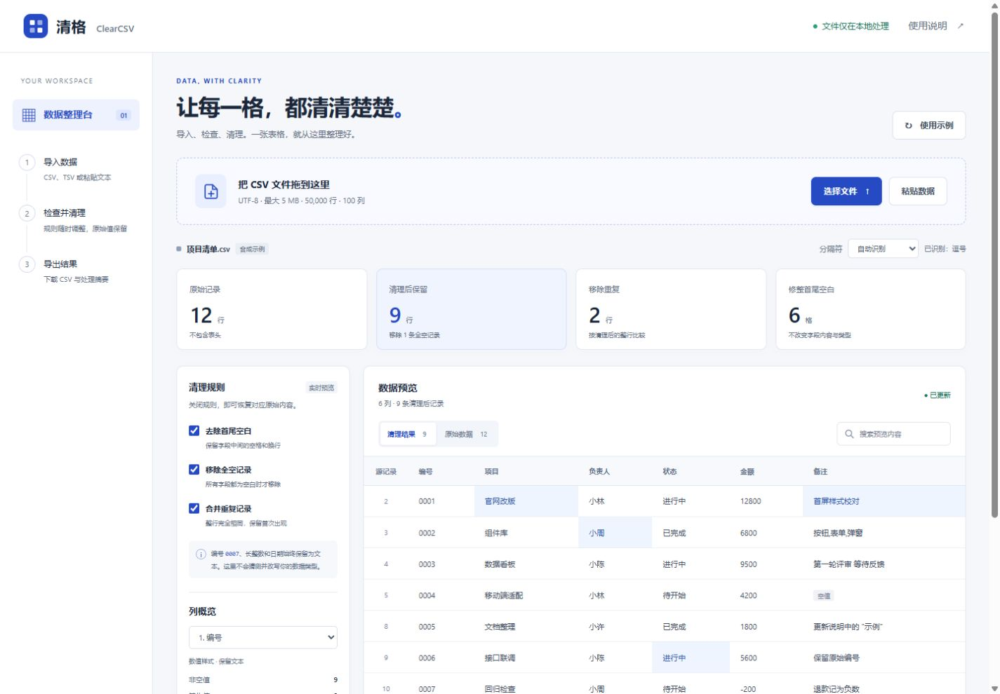
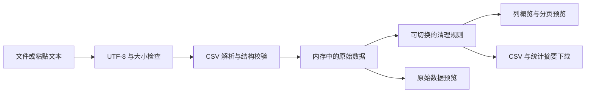

# 清格 ClearCSV

在浏览器本地导入、检查、清理和导出 CSV 的轻量工作台。无需账号，无第三方依赖，不上传文件，不持久保存导入的数据。



## 运行

使用 Node.js 20 或更高版本，在此目录运行：

```sh
node server.cjs
```

访问终端显示的本地地址。预览服务只监听 `127.0.0.1:4173`，只提供五个应用文件；按 Ctrl+C 停止。端口占用时可设置环境变量 `CLEARCSV_PORT`。无需运行 `npm install`。

应用由纯静态文件组成，也可部署到静态站点。本次浏览器验证使用本地 HTTP 服务；直接通过 `file://` 打开不属于已验证的运行方式。

## 使用

1. 拖入 UTF-8 CSV / TSV 文件、选择文件，或粘贴文本；第一条记录是表头。
2. 检查分隔符，按需开关首尾空白修整、全空记录移除、整行去重。
3. 切换原始数据核对来源，查看列概览。搜索与每页 50 行分页仅影响预览。
4. 下载清理后的 CSV，或不含单元格、列名和原文件名的 JSON 处理摘要。

首页自带 **合成示例**：12 条原始记录，默认规则保留 9 条，移除 2 条重复和 1 条全空记录，修整 6 个字段。所有统计由实际解析结果计算。

## 处理规则

- 支持逗号、Tab、分号、竖线；自动识别前 20 条记录，也可手动指定。
- 支持 BOM、双引号转义、引号内分隔符与换行，以及 CRLF / LF / CR 行结束符。
- 清理按“首尾修整 → 全空记录移除 → 整行精确去重”执行，保留首次出现的记录。
- 编号、长整数、日期和其他内容始终以字符串处理；不推断或转换类型。
- 原始数据保留在内存中，不受清理规则影响。源记录号包含表头，跨行字段仍属于同一条逻辑记录。
- 不完整引号、非法引号和非空记录列数不一致会阻止导出；不会默默截断或补齐异常列。
- 空表头和重复表头保留并提醒；只含空白的表头拒绝导入。
- 最多 5 MiB UTF-8 输入、50,000 条数据记录、100 列；不支持 XLSX、GBK、后台持久化或超大文件流式处理。

## 导出与安全边界

CSV 导出为逗号分隔、UTF-8 BOM、CRLF 记录分隔符。默认公式前缀保护会给疑似公式文本添加单引号，涵盖表头；例如 `=1+1` 变为 `'=1+1`，普通负数 `-200` 保持原样。关闭保护后可保留原始字段值，但本工具不保证任意表格软件如何解释导入的数据。Excel 直接打开 CSV 仍可能自行推断类型；需要严格保留前导零时，请在表格软件的导入向导中把对应列设为文本。

页面将数据写入 `textContent`，不会把 CSV 内容解释成 HTML。CSP 禁止网络连接，无统计脚本、外部字体、服务端上传、localStorage 或 IndexedDB。浏览器扩展和宿主环境不在此应用控制范围内。

## 验证

```sh
node --test tests/core.test.cjs
```

核心测试和真实浏览器验证结果见 [VALIDATION.md](VALIDATION.md)。这里的“本地处理”描述应用代码行为，不是第三方安全审计或所有 CSV 方言的兼容性承诺。

## 结构

```text
index.html          语义化界面、对话框、CSP
styles.css          桌面与手机布局、键盘焦点、减少动画适配
core.js             解析、清理、列统计、CSV 序列化
app.js              文件输入、预览、分页、搜索、下载
server.cjs          仅供本地预览的静态服务
tests/core.test.cjs  Node 内置测试，无测试框架依赖
```



## 创作说明

原创实现，AI 辅助设计、编码、文档和测试。示例数据为合成数据，不含真实客户、个人或业务信息。项目源码发布于 [GitHub](https://github.com/IT-axiosjj/clearcsv)，本地运行方式见上文；尚未部署公网演示，也未提交作品馆。未经作者另行许可，不授予复用代码的许可；本仓库未添加开源许可证。
